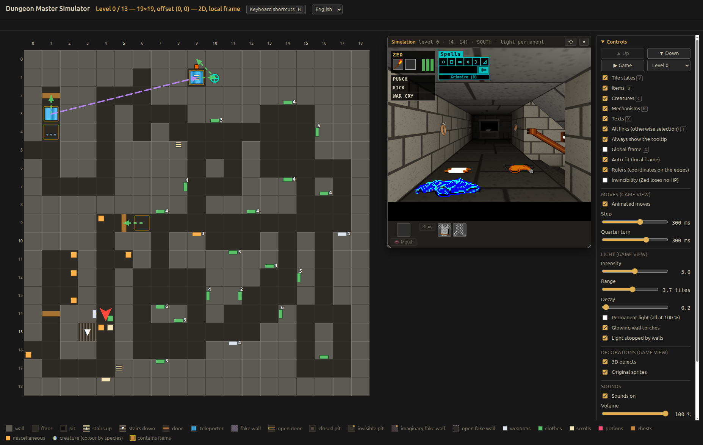
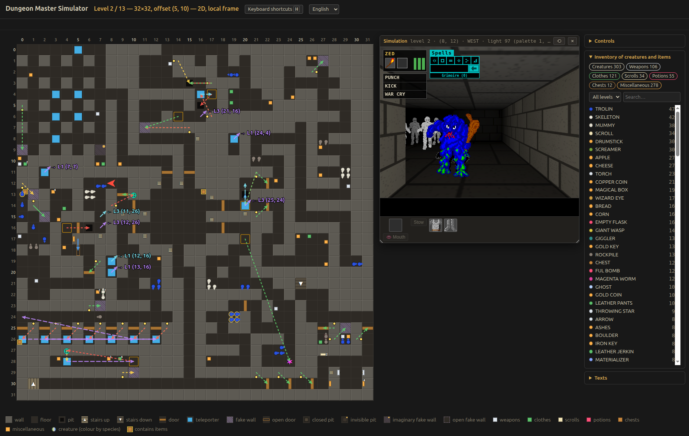
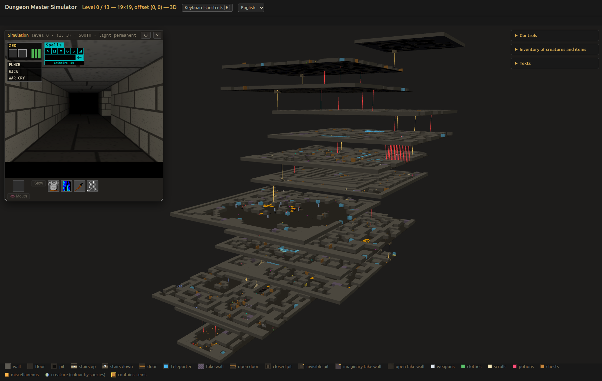
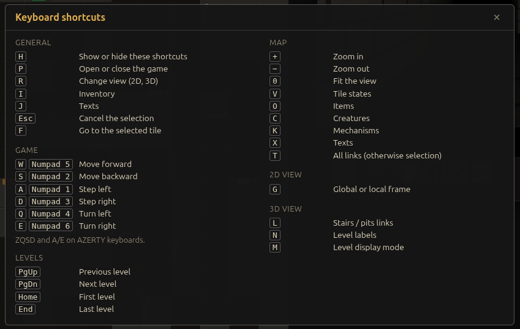

# Dungeon Master Simulator

## Project context

I've been a long time *DM* player, stuck in the dungeons since 1989. I just played *Dungeon Master* to the end and the first levels of *CSB* on *ST/Amiga* at the time. I have not played custom dungeons etc. but played with the tools and the resources on the *Encyclopedia* and other websites.

I made lots of *"DM engine"* from scratch with *AMOS*, *Flash*, *JS*, *Unity*... but never went to something playable. One frustration I had as a player was to be lost while playing again, I'd like to know the levels, the riddles, the hidden walls etc. A few years ago I started to extract the data with *SCK* in *XML* format, creating a viewer upon it with *Three.js*. I struggle with the nested objects (like in chests) and finally let the project aside.

## Vibe coding era

Since the ascent of AI coding, I always refrain myself starting using it, feeling like I was cheating or something like this. To the day someone shows me how to use *Claude Code*... I thought it was time to test *Claude Code* against that *Dungeon Master Simulator* project.

## Objectives

The goal of this project is not to make another DM clone, it is more **a tool to play with the first DM dungeon**. So *for now*, **you can't upload any custom dungeon** to visualise and play with.

## Process

Here's how I guide the AI agent.

- I started with the *XML* of `dungeon.dat` exported with *Swoosh Construction Kit*.
- I iterate over and over with the features I wanted to have in the simulator
- At the beginning, I did not espacially want *Claude* to look at the source code of the major *DM* demakes/remakes.
- But at some point, it was easier to go and look for some items or creatures tables, actions management etc. (not all the features of *DM* are included).
- I iterate over two full weeks to obtain 119 commits.

## Languages

- Source code is in english.
- Commits are in French (sorry about that ^^).
- Docs are in french (oops, I could easily translate them if needed).
- **The simulator uses the 3 *DM* languages by default in Europe : English, Français, Deutsch**.

## Usage and screens

- You play a unique character : *Zed Duke of Banville*, there's no party.
- Keyboard shorcuts are accessible via <kbd>H</kbd>.
  - ***Right click* on the map to hack the game** :wink:
- You have 3 panels on the right : *Controls*, *Inventory of creatures and items*, *Texts*.
- You can switch language (interface and game). Deutsch has not be verified (interface).
- Switch to 2D/3D maps with <kbd>R</kbd>.

### Level 0

### Creatures

### 3D maps

### Shortcuts

## Sources

I ask *Claude* to list every source it uses to generate the code, here it is :

### Files provided by the author

1. **`Dungeon.xml`**: commented XML dump of `DUNGEON.DAT`, the main source.
2. **`DungeonF.DAT.xml` and `DungeonG.DAT.xml`**: the French and German dungeons.
3. **`map.php` and `reader.php`**: first attempts at reading the XML.
4. **SCK extraction of `graphics.dat`**: images of the items, projectiles and icons.
5. **Creature GIFs** (`assets/creatures/`): from http://dmweb.free.fr/.

### Greatstone (DM Amiga 3.6, CAPS version)

6. **graphics.dat page**: http://greatstone.free.fr/dm/db_data/dm_amiga_36_caps/graphics.dat/graphics.dat.html (graphics labels, creature colours, sounds, items, engine texts).
7. **MP3 sounds**: http://greatstone.free.fr/dm/db_data/dm_amiga_36_caps/graphics.dat/ (`.SND2` files).
8. **Dungeon maps**: `dungeon.dat/dungeon.html`, `dungeonf.dat`, `dungeong.dat` (`map_1` to `map_14`).

### Dungeon Master Encyclopaedia (http://dmweb.free.fr/)

9. *Creature Details*: `community/documentation/dungeon-master-and-chaos-strikes-back/creature-details/`
10. *Creature Generators*: `…/creature-generators/`
11. *Graphics.dat Item 558*: `…/graphics.dat-item-558/`
12. *Graphics.dat Item 559*: `…/graphics.dat-item-559/`
13. *Actions and Combos*: `…/actions-and-combos/`
14. *Attacks and Defenses*: `…/attacks-and-defenses/`
15. *Skills and Statistics*: `…/skills-and-statistics/`
16. *Items properties*: `…/items-properties/`
17. *Dungeon Files*: `community/documentation/file-formats/dungeon-files/`
18. *Dungeon Master Items*: `games/dungeon-master/solutions/items/`
19. *Dungeon Master Creatures*: `games/dungeon-master/solutions/creatures/`
20. *Spells*: `games/dungeon-master/solutions/spells/`
21. Spell symbol icons (Atari ST): `files/Game,Dungeon_Master,Atari_ST,Symbol,<name>,Screenshot.png`

### Engine source code

22. **ReDMCSB Release 2** (Christophe Fontanel, GitHub mirror): https://github.com/gondur/ReDMCSB_Release2. Files read: `TIMELINE.C`, `DUNVIEW.C`, `COMMAND.C`, `GROUP1.C`, `GROUP2.C`, `PROJEXPL.C`, `CHAMPION.C`, `MENUS.C`, `INVNTORY.C`, `MAIN.C`, `SOUND.C`, `MOVE.C`, `SENSOR.C`, `OBJECT.C`, `DUNGEON.C`, `DEFS.H`.
23. **ScummVM, DM engine**: https://github.com/scummvm/scummvm. Files read: `engines/dm/champion.cpp`, `inventory.cpp`, `objectman.cpp`, `dungeonman.cpp`.

### Libraries and tools

24. **Three.js 0.170.0**: https://threejs.org/, served by the jsDelivr CDN.
25. **Chrome DevTools Protocol**: https://chromedevtools.github.io/devtools-protocol/
26. **Pillow**: https://python-pillow.org/

The full list, with what each source was used for, is in [docs/000-sources.md](docs/000-sources.md) (in French).

## Copyright

Dungeon Master, its data, graphics and sound files and its original executables are the property of FTL Games.